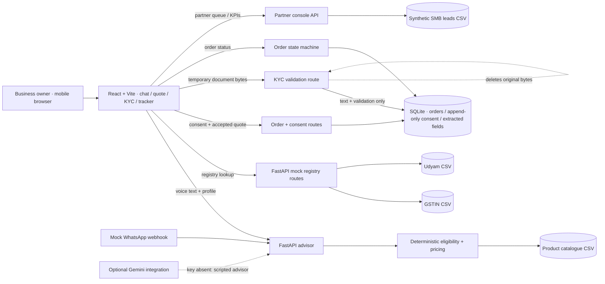

# Architecture

The catalogue is the only source for monthly prices, setup fees, contract terms, and install estimates. Eligibility, recommendation validation, and price aggregation are deterministic backend functions. The current advisor uses the deterministic fallback; the UI's speech input/output uses browser Web Speech APIs when available. KYC images supplied for this demo are synthetic specimens. The upload route returns a specimen warning and retains no image bytes; live OCR requires an installed Tesseract executable and is not used to approve identity.

The consent ledger appends the four purpose choices at order creation. Orders are stored in local SQLite. GSTIN and Udyam lookups are read-only CSV-backed mock APIs. The partner console reads only lead pipeline fields and never exposes the KYC table.
